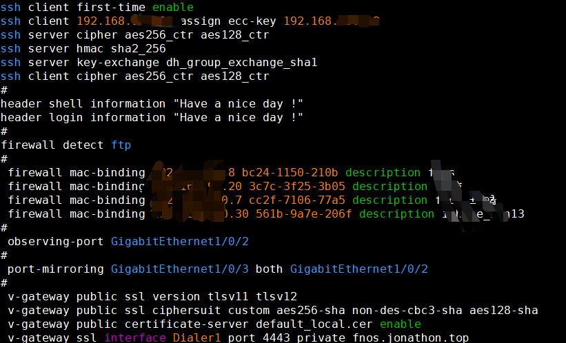
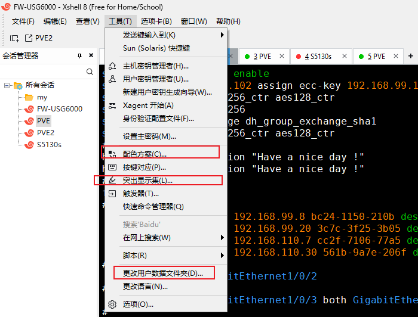

# XShell_HighlightSet
XShell高亮方案和ColorScheme

详细方法参考下方：[地址](https://www.cnblogs.com/Magiclala/p/19287883)

**效果如下图**

**文件位置**

> 操作：将文件放到对应文件夹位置然后选中即可。
>
> HighlightSet Files：**突出高亮**
>
> ColorScheme Files：**配色**

